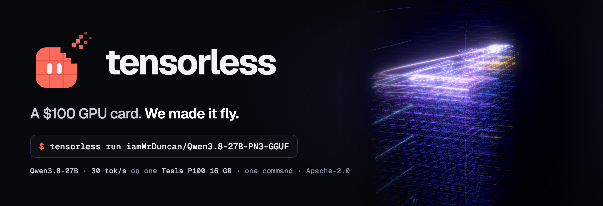

<p align="center"></p>

# tensorless

<p align="center"><a href="https://huggingface.co/collections/iamMrDuncan/tensorless"></a></p>

**The models are on [Hugging Face](https://huggingface.co/collections/iamMrDuncan/tensorless)**: every launch target, in one collection.

**Join us on [Discord](https://discord.gg/3Qs2uejUf9)**: questions, results from your own P100, and ideas.

**[Credits](CREDITS.md)**: the projects, papers, models, datasets and people tensorless is built on.

Custom engine + quant inference for P100s. A ~$100 GPU card, and we will make it fly.

tensorless runs a model that was tuned for your GPU, on the engine it was tuned with, in one command:

```sh
tensorless run iamMrDuncan/Qwen3.8-27B-PN3-GGUF
```

The first target is the NVIDIA Tesla P100 (16 GB, sm_60), running Qwen3.8-27B-PN3: a 3-bit quantization of Qwen3.8-27B made for this card, served by a llama.cpp-based engine with kernels written for Pascal.

**Status: v0.4.0 released.** The launcher, the engine image `0.4.0-sm60` and the models of all three launch targets are published, and the published image has been measured on a real P100 for each launch target. How the pieces fit together, and how engine releases are made, is in [docs/design.md](docs/design.md).

**New in v0.4.0: models that are more than one file.** A recipe can now name a pack: several files of a Hugging Face repository that the engine reads in place, after a short prepare step in the engine image writes a small GGUF that names them. The launcher downloads and checks each file into the Hugging Face cache, as it does one ([recipe file](recipes/README.md#a-pack-instead-of-one-file)). The first such model, Inkling-2-Mini, is in this release as a draft recipe ([below](#launch-targets)). The three launch targets moved to engine-v0.4.0 with one setting added, `GGML_CUDA_SYNC_SCHED = "auto"`, which keeps engine-v0.3.0's way of waiting for the GPU; the published image was measured with each of them ([receipts](docs/receipts/engine-v0.4.0/)).

v0.3.0 added North-Mini-Code-1.0, whose decode hill climb took it from 49 to 80 tok/s after a 4,096-token prompt ([receipt](docs/receipts/engine-v0.3.0/North-Mini-Code-1.0-GGUF-p100.md)). v0.2.0 made Qwen3.8-27B-PN3's prompts faster: from 121 to 200 tok/s on a 4,100-token prompt ([receipt](docs/receipts/engine-v0.2.0/Qwen3.8-27B-PN3-GGUF-p100.md)).

## Launch targets

Copy a command and run it. Each one is a recipe: the engine image, model file and settings that were measured on that card.

| Command | Card | Decode | Prefill | Decode at 32K |
|---|---|---:|---:|---:|
| `tensorless run iamMrDuncan/Qwen3.8-27B-PN3-GGUF` | 1× Tesla P100 16 GB | 30.4 | 200 | – |
| `tensorless run iamMrDuncan/Qwen3.8-27B-UD-IQ3_XXS-Q3Floor-GGUF` | 1× Tesla P100 16 GB | 26.5 | – | 24.5 |
| `tensorless run unsloth/North-Mini-Code-1.0-GGUF` | 1× Tesla P100 16 GB | 79.8 | 446 | 66.1 |
| `tensorless run shinmegamiboson/Inkling-2-Mini-LookAtMyQuant-12.8GB --allow-draft` (draft) | 1× Tesla P100 16 GB | 28.5 | 240 | 25.5 |

Card is how many cards and which: every launch target today runs on one. Tokens a second, greedy, from each recipe's `[receipt]`. Decode is measured after a short prompt (North-Mini-Code-1.0: 4,096 tokens), prefill on a cold prompt of about 4,000 tokens, and decode at 32K after a 32K prompt. – means not measured yet. A draft has not yet passed the release gate on its published image. The measurements in full, and the published image's own, are in [docs/receipts/](docs/receipts/) and on [Launch targets](https://tensorless.dev/docs/reference/launch-targets/). `tensorless models` lists the recipes your launcher knows.

## Quick start (Linux, Tesla P100)

You need:
- an NVIDIA driver from R525 to R580 (R580 is the last branch that supports Pascal);
- podman or docker;
- the NVIDIA container toolkit;
- about 13 GB of free disk space for the model, plus a few GB for the image.

```sh
# NVIDIA container support (once): podman uses CDI
sudo nvidia-ctk cdi generate --output=/etc/cdi/nvidia.yaml

# the launcher: a single static binary
V=0.4.0
curl -fLO https://github.com/iammrduncan/tensorless/releases/download/v$V/tensorless-$V-linux-x86_64.tar.gz
curl -fLO https://github.com/iammrduncan/tensorless/releases/download/v$V/tensorless-$V-linux-x86_64.tar.gz.sha256
sha256sum -c tensorless-$V-linux-x86_64.tar.gz.sha256 && tar -xzf tensorless-$V-linux-x86_64.tar.gz
cd tensorless-$V-linux-x86_64

./tensorless doctor                                                # checks GPU, driver, runtime, GPU passthrough, disk
./tensorless run iamMrDuncan/Qwen3.8-27B-PN3-GGUF                  # pulls, verifies, serves on 127.0.0.1:8080
```

Then, from another terminal:

```sh
curl -s http://127.0.0.1:8080/v1/chat/completions -H 'Content-Type: application/json' \
  -d '{"model":"iamMrDuncan/Qwen3.8-27B-PN3-GGUF","messages":[{"role":"user","content":"Say hello in one sentence."}],"max_tokens":64}'
./tensorless bench iamMrDuncan/Qwen3.8-27B-PN3-GGUF                # decode tok/s, compared with the recipe's receipt
```

Stop the GPU's other users first: the model and its 65,536-token context take nearly all of the card's 16 GB. Every command is described in [docs/launcher.md](docs/launcher.md).

## How it fits together

- **Engine** (`engine/`): the inference engine source, a llama.cpp fork, published at each release.
- **Images**: one container image per engine release and GPU architecture, pinned by digest.
- **Recipes** (`recipes/<org>/<repo>/<card>.toml`): one model, named by its Hugging Face repository, on one card. A recipe names the exact image, model file, settings and measured numbers.
- **Launcher** (`tensorless`): detects your GPU, picks the recipe, pulls and verifies the image and the model, and starts an OpenAI-compatible server.

## License

Apache-2.0. The engine is derived from MIT-licensed projects (llama.cpp, llama-cpp-turboquant, llamAmpere); see [NOTICE](NOTICE) and [LICENSES/](LICENSES/). Model weights keep their own licenses.
