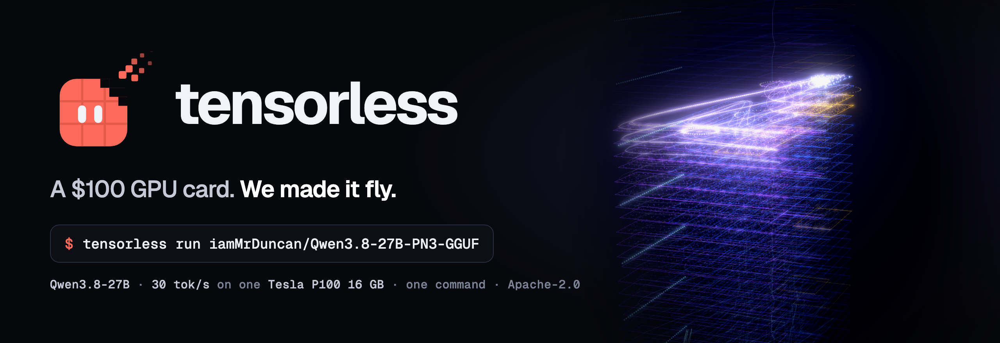

<p align="center"></p>

# tensorless

<p align="center"><a href="https://huggingface.co/collections/iamMrDuncan/tensorless"></a></p>

**The models are on [Hugging Face](https://huggingface.co/collections/iamMrDuncan/tensorless)**: every launch target, in one collection.

**Join us on [Discord](https://discord.gg/3Qs2uejUf9)**: questions, results from your own P100, and ideas.

**[Credits](CREDITS.md)**: the projects, papers, models, datasets and people tensorless is built on.

Custom engine + quant inference for P100s. A ~$100 GPU card, and we will make it fly.

tensorless runs a model that was tuned for your GPU, on the engine it was tuned with, in one command:

```sh
tensorless run iamMrDuncan/Qwen3.8-27B-PN3-GGUF
```

The first target is the NVIDIA Tesla P100 (16 GB, sm_60), running Qwen3.8-27B-PN3: a 3-bit quantization of Qwen3.8-27B made for this card, served by a llama.cpp-based engine with kernels written for Pascal.

**Status: v0.1.0 released.** The launcher, the engine image `0.1.0-sm60` and both models are published, and the published image has been measured on a real P100 for each launch target. How the pieces fit together, and how engine releases are made, is in [docs/design.md](docs/design.md).

**Next: engine-v0.2.0, a release candidate.** A prefill hill climb took Qwen3.8-27B-PN3's prompt speed from 121 to 200 tok/s on a 4,100-token prompt, with the same settings and no loss of decode speed. Its source is in `engine/`, and the Qwen3.8-27B-PN3 recipe is a draft on it until the new image is built and measured on a P100 ([receipt](docs/receipts/engine-v0.2.0/Qwen3.8-27B-PN3-GGUF-p100.md)). The table below is the v0.1.0 release.

## Launch targets

Every model tensorless can launch today. Each row is a recipe: the exact engine image, model file and settings that were measured on that card.

| Launch command | Model | Card | Engine | Decode, short context | Decode, 32K / 65K | Status |
|---|---|---|---|---:|---:|---|
| `tensorless run iamMrDuncan/Qwen3.8-27B-PN3-GGUF` | **Qwen3.8-27B-PN3**: Qwen3.8-27B in our own P100-native 3-bit weight format ([PN](docs/pn-format.md)), 12.1 GiB | Tesla P100 16 GB | engine-v0.1.0 | **30.1 tok/s** | not yet measured | **released**; published image measured at **30.03 tok/s** |
| `tensorless run iamMrDuncan/Qwen3.8-27B-UD-IQ3_XXS-Q3Floor-GGUF` | **Qwen3.8-27B-UD-IQ3_XXS-Q3Floor**: Unsloth's Qwen3.8-27B UD-IQ3_XXS with its 91 sub-3-bit tensors re-quantized to IQ3_XXS, a 3-bit floor (standard llama.cpp types; the model the P100 kernels were first tuned on), 11.0 GiB | Tesla P100 16 GB | engine-v0.1.0 | 26.3 tok/s | 24.5 / 22.9 tok/s, on the climb's starting commit | **released**; published image measured at **26.18 tok/s** |

Decode is greedy single-stream generation: "short context" is 256 tokens after a prompt of about 600 tokens, and 32K/65K is 1,024 tokens after a prompt that fills the context. The decode columns come from the research hill climb's judge, measured on one P100 with a source build of the engine. The status column has the published image's own measurement with `tensorless bench` (256 tokens after a 429-token prompt), taken before each recipe was marked released. The receipts are in [docs/receipts/](docs/receipts/), and `tensorless models` lists the recipes your launcher knows.

## Quick start (Linux, Tesla P100)

You need:
- an NVIDIA driver from R525 to R580 (R580 is the last branch that supports Pascal);
- podman or docker;
- the NVIDIA container toolkit;
- about 13 GB of free disk space for the model, plus a few GB for the image.

```sh
# NVIDIA container support (once): podman uses CDI
sudo nvidia-ctk cdi generate --output=/etc/cdi/nvidia.yaml

# the launcher: a single static binary
V=0.1.0
curl -fLO https://github.com/iammrduncan/tensorless/releases/download/v$V/tensorless-$V-linux-x86_64.tar.gz
curl -fLO https://github.com/iammrduncan/tensorless/releases/download/v$V/tensorless-$V-linux-x86_64.tar.gz.sha256
sha256sum -c tensorless-$V-linux-x86_64.tar.gz.sha256 && tar -xzf tensorless-$V-linux-x86_64.tar.gz
cd tensorless-$V-linux-x86_64

./tensorless doctor                                                # checks GPU, driver, runtime, GPU passthrough, disk
./tensorless run iamMrDuncan/Qwen3.8-27B-PN3-GGUF                  # pulls, verifies, serves on 127.0.0.1:8080
```

Then, from another terminal:

```sh
curl -s http://127.0.0.1:8080/v1/chat/completions -H 'Content-Type: application/json' \
  -d '{"model":"iamMrDuncan/Qwen3.8-27B-PN3-GGUF","messages":[{"role":"user","content":"Say hello in one sentence."}],"max_tokens":64}'
./tensorless bench iamMrDuncan/Qwen3.8-27B-PN3-GGUF                # decode tok/s, compared with the recipe's receipt
```

Stop the GPU's other users first: the model and its 65,536-token context take nearly all of the card's 16 GB. Every command is described in [docs/launcher.md](docs/launcher.md).

## How it fits together

- **Engine** (`engine/`): the inference engine source, a llama.cpp fork, published at each release.
- **Images**: one container image per engine release and GPU architecture, pinned by digest.
- **Recipes** (`recipes/<org>/<repo>/<card>.toml`): one model, named by its Hugging Face repository, on one card. A recipe names the exact image, model file, settings and measured numbers.
- **Launcher** (`tensorless`): detects your GPU, picks the recipe, pulls and verifies the image and the model, and starts an OpenAI-compatible server.

## License

Apache-2.0. The engine is derived from MIT-licensed projects (llama.cpp, llama-cpp-turboquant, llamAmpere); see [NOTICE](NOTICE) and [LICENSES/](LICENSES/). Model weights keep their own licenses.
