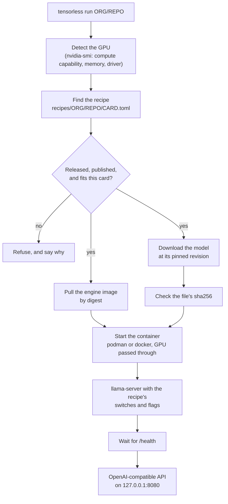

This page explains what `tensorless run` does, piece by piece, and why it is built that way. You don't need it to run a model; the [first tutorial](../tutorials/first-model.md) is enough for that. Read it when you want to know what you are trusting.

## Four pieces

tensorless is four things that fit together:

- **The engine:** the inference code, a fork of llama.cpp with kernels written for the Tesla P100. Its source is in the repository's [`engine/`](https://github.com/iammrduncan/tensorless/tree/main/engine) folder.
- **The image:** one container image per engine release and GPU architecture, such as `ghcr.io/iammrduncan/tensorless-engine:0.2.0-sm60`. It holds the built `llama-server` and nothing else that matters to speed.
- **The recipe:** one model on one card, in a small TOML file. It names the exact image (by digest), the exact model file (by revision and sha256), the settings that were measured, and what those settings measured.
- **The launcher:** the `tensorless` command. It reads the recipe and makes it happen on your machine.

The launcher holds no inference code. Everything numerical happens inside the image, the same bytes that were measured.

## What one command does

```sh
tensorless run iamMrDuncan/Qwen3.8-27B-PN3-GGUF
```



1. **It finds the card.** The launcher asks `nvidia-smi` for each GPU's compute capability, memory and driver version.
2. **It finds the recipe.** The model argument is a Hugging Face repo id. The launcher looks for that repository's recipe for the detected card, such as `recipes/iamMrDuncan/Qwen3.8-27B-PN3-GGUF/p100.toml`. The recipes are built into the launcher, so a new model arrives with a new launcher release.
3. **It checks the recipe can run here.** The card's compute capability must equal the recipe's, its memory must be at least the recipe's minimum, and the driver must be at least `min_driver`. A draft recipe, or one with placeholder values, is refused.
4. **It pulls the image by digest.** Not by tag: a tag can be moved, a digest cannot.
5. **It downloads the model** into the Hugging Face cache, at the commit the recipe pins, and checks its sha256. Other Hugging Face tools can read the same file.
6. **It starts the container** with the model mounted read-only, the recipe's engine switches as environment variables, and the recipe's `llama-server` flags.
7. **It waits for the server** to report healthy, then prints the address. From there it is a normal OpenAI-compatible server: `/v1/chat/completions`, `/v1/completions`, `/v1/models`.

The [command-line reference](../reference/cli.md) has each command, and `tensorless info` shows every one of these values for a model before anything is downloaded.

## Three rules behind it

### Pin everything

A recipe's numbers are only true for the exact bytes they were measured on. So the recipe names the image by digest and the model by commit and sha256. If you change any of them, you are no longer running what was measured. That is also why recipes are reviewed like code: a change to a recipe's engine or run settings needs a new measurement.

### Refuse rather than guess

The launcher would rather stop with a clear reason than run something that might be slow, wrong or broken:

- no recipe for this card: it stops, instead of trying the nearest one;
- a hash that does not match: it stops, instead of loading the file;
- a driver too old for the image: it stops, with the version you need;
- a host where some GPUs don't fit the recipe: it gives the container only the matched card, so the server cannot land on a card the image was not built for.

`tensorless doctor` runs the same checks up front and prints the command that fixes each one.

### Label what changed

Another port or address changes nothing that was measured. A shorter context or an extra server flag is allowed, but the launcher tells you the run is **untuned**, because the receipt's numbers no longer apply. [Tuned and untuned runs](tuned-and-untuned.md) explains where that line is.

## Why containers

The engine needs a specific CUDA runtime (12.x for the P100, because CUDA 13 dropped Pascal) and a specific build of its libraries. Shipping that as a container image means:

- **the host only needs the NVIDIA driver,** not a CUDA toolkit;
- **what runs on your machine is byte for byte what was measured,** because the image is pinned by digest;
- **nothing is built on your machine,** so the result does not depend on your compiler or your CPU.

The cost is that you need podman or docker with NVIDIA container support. [Prepare a host](../how-to/setup/prepare-host.md) covers that.

## Why one image per architecture, not per model

One engine build serves every model on a card. What differs between models is configuration: which kernels to switch on, the context length, the KV-cache type, batch sizes. That is data, so it lives in the recipe. A fix to the engine is then one rebuild, not one per model.

Each GPU architecture gets its own image because the kernels are built and measured for one architecture. The P100 image holds `sm_60` code and nothing else. A single image for several cards would not be the build that was measured. [How a release is made](releases-and-receipts.md) goes further.
