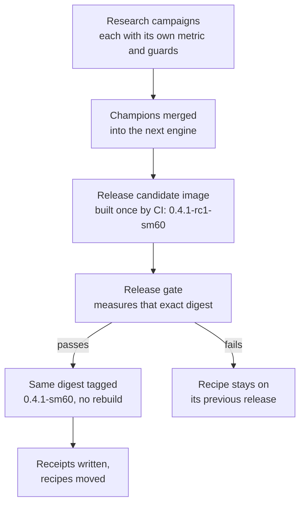

Every speed tensorless publishes comes with a receipt: what was measured, on what, by whom. This page explains how an engine release is made, why the image you pull is byte for byte the one that was measured, and how to read a receipt's scope.

## One lineage, many images

There is one engine, and it moves forward in releases: engine-v0.1.0, engine-v0.2.0, engine-v0.3.0, engine-v0.4.0, engine-v0.4.1, then the next. Each release is built once for each GPU architecture it supports, and each build is one container image:

```text
ghcr.io/iammrduncan/tensorless-engine:0.4.1-sm60
                                      └─┬─┘ └┬─┘
                              engine release  GPU architecture
```

Recipes never point at that tag. They point at the image's **digest**, the sha256 of its manifest, which no one can move. A tag is a name for people; the digest is what runs.

Older images stay in the registry. A model whose recipe has not moved to a new release keeps running on the release it was measured with. So a new release never silently changes a model you already use: its recipe has to move, and a recipe moves only with a new receipt.

## From champion to release



engine-v0.1.0, engine-v0.2.0 and engine-v0.3.0 are each a single hill climb's champion, and engine-v0.4.0 is the champion of a goal campaign, which aims at a set of goals rather than one metric. engine-v0.4.1 is engine-v0.4.0 plus the champion of a fifth campaign, a prefill hill climb on North-Mini-Code-1.0. The first four each started from the release before it: the first was exported as is, the second with one fix, the third with two fixes and a build flag, the fourth as is. The fifth started from engine-v0.3.0 with one fix, so its champion was applied onto engine-v0.4.0, which its judge never ran. Each one's published image went through steps 3 to 6.

1. **Campaigns find improvements.** Each hill-climb campaign starts from the latest engine release and keeps its best change, its **champion** ([Where the engine comes from](the-engine.md)).
2. **Champions are merged** into the next engine, with a check that each one's changes are really there. A champion only had to beat its own campaign's previous best, so a change that was lost along the way is re-applied and measured again.
3. **CI builds a release candidate once.** A GitHub workflow builds the engine image from the repository's Containerfile and publishes it as, for example, `0.4.1-rc1-sm60`. Its digest is printed for the gate.
4. **The release gate measures that digest** on a real card, for every recipe that will move to it.
5. **The measured digest becomes the release.** A second workflow copies the image to its release tag, `0.4.1-sm60`, without rebuilding it, then checks that the tag points at exactly the measured digest. If the digests differ, it fails.
6. **The receipts are written and the recipes move,** in the same change.

Step 5 is the important one. A rebuild, even from the same source, can produce a different binary. Promoting the measured digest instead means the release is not "built the same way as what was measured": it *is* what was measured.

For engine-v0.4.1, `0.4.1-rc1-sm60` and `0.4.1-sm60` are the same image, `sha256:c89e60b34a0f6098db20f2f2b43c78a93bb70192833cf7656b4a84ae8974346a`.

## What the gate checks

The design asks the release gate for these, on each card, for each recipe:

- the build's own checks (the P100 image runs the PN format's golden tests while it builds);
- each model's numerics against the previous release, within that model's recorded bars;
- speed no worse than any merged champion, within measured noise;
- decode at long contexts (32K and 65K on the P100) and prefill;
- the model's quality checks, once per release.

engine-v0.1.0 was the first release, so there was no previous release to compare against. Its numerics and quality were held by the hill climb that produced it, and the published image was then measured on a P100 for both recipes.

engine-v0.2.0 came from a prefill climb whose judge held each step's numerics against engine-v0.1.0. Its gate measured decode and prefill on the published image for both recipes, next to engine-v0.1.0's image on the same card. It also ran a multi-turn chat, which the climb's judge never did. On a first build of the champion's source that chat aborted the server, and the release carries the fix.

engine-v0.3.0 came from a decode climb on a new model, North-Mini-Code-1.0, whose judge held each step's numerics against its starting point. Its gate measured all three recipes on the published image. For North-Mini-Code-1.0 that was decode after about 4,000 and 32,000 tokens, prefill, a cached chat, memory and a load with no GPU. For the Qwen3.8-27B models, whose recipes did not change, it repeated engine-v0.2.0's tests and compared them with engine-v0.2.0's receipts. The chat answered for all three, but North-Mini-Code-1.0's answers changed when it reused the prompt cache. The climb's judge had seen the same, so it is recorded as a known limit. Long-context decode for the Qwen3.8-27B models and the models' quality checks have not been measured on this engine yet, and the receipts say so. [Known limits](../project/known-limits.md) keeps the list.

engine-v0.4.0 came from a goal campaign on a new model, Inkling-2-Mini, read in place from a pack of 63 files, whose judge held its output against the pack's own float32 reference. The owner kept that model out of this release's gate, so its recipe ships as a draft and moves to released in a later patch release, once its gate has run. The gate measured the three launch targets on the published image: North-Mini-Code-1.0 with engine-v0.3.0's full set of tests, and the Qwen3.8-27B models with `tensorless bench`. It found one change that reaches every model: the engine now makes the host thread sleep while it waits for the GPU (`blocking`), where engine-v0.3.0 let the CUDA driver choose (`auto`). That cost Qwen3.8-27B-PN3 about 1%, so the three recipes set `GGML_CUDA_SYNC_SCHED = "auto"` and were measured with it. One run of North-Mini-Code-1.0 also used 864 MiB more GPU memory after a chat turn that reused the prompt cache, for a reason not yet known; its receipt records it.

engine-v0.4.1 came from a prefill climb on North-Mini-Code-1.0, whose judge timed a cold 4,096- and 32,768-token prompt and held decode, the teacher-forced output and the card's free memory against its starting point. Its seven changed files are CUDA code for prompt processing on sm_60, on by default, and the recipes did not change. Its gate measured the published image next to engine-v0.4.0's, for all three launch targets, on the same card and in the same hour. Every greedy reply was the same, byte for byte, on both images: three prompts for each model. North-Mini-Code-1.0's prefill was about 40% faster on a prompt of about 4,000 tokens and 22% faster at about 32,000, by the server's own timer, and its decode stayed within 0.5%. The Qwen3.8-27B models read the same on both images. Qwen3.8-27B-PN3's bench read about 1% below engine-v0.4.0's own gate on both images, so that difference comes from the card or the hour, not from the release. The step in GPU memory that engine-v0.4.0's gate recorded in North-Mini-Code-1.0's chat came on both images too, so it is not new in engine-v0.4.1.

If a change helps one model and fails another's check, the design's answer is not to fork the engine. The failing model's recipe stays on the previous release, and the release notes record why.

## What "measured" means

Two kinds of measurement appear in the receipts, and both time decode the same way: from outside the engine, by stamping each streamed token as it arrives.

- **The research judge** built the engine from source with the image's CUDA configuration and timed it on one P100: 256 greedy tokens after a cold prompt of about 600 tokens, the median of confirmation blocks. This is where a recipe's `decode_tps` comes from.
- **`tensorless bench`** measures the published image the same way: a warm-up, then greedy runs with a fixed seed and no prompt cache, decode speed as tokens over the time between the first and last streamed token. Its prompt is different (the start of the Apache-2.0 license text), so expect a few percent of difference from the research number.

For engine-v0.4.1, the published image measured within about one percent of the research numbers: 30.30 against 30.43 tok/s for Qwen3.8-27B-PN3, 26.62 against 26.53 for Qwen3.8-27B-UD-IQ3_XXS-Q3Floor, and for North-Mini-Code-1.0 80.39 against 79.77 after about 4,000 tokens and 66.80 against 66.06 after about 32,000. North-Mini-Code-1.0's research numbers come after a 4,096-token prompt, so `tensorless bench` reads it 18.9% higher, at 94.87 tok/s.

Timing between streamed tokens, rather than trusting the server's own timer, means the number is what a client sees. It also means a slow network adds to the time to the first token but not to the decode rate. You can run `tensorless bench` on your own card and compare: [Benchmark a running server](../how-to/use/benchmark.md).

## How to read a receipt

A number on its own says little. A receipt gives every number its **scope**:

- **which build:** a source build of a research commit, or the published image by digest;
- **which model file:** by sha256;
- **which card:** a Tesla P100-PCIE-16GB, its reported compute capability and memory;
- **what work:** how many tokens, after how long a prompt, code or prose, greedy or not, how many runs;
- **what was not measured.**

Read the last item as carefully as the others. "30 tok/s" is true at short context. It is not a claim about 65K context, about batched requests, or about a run with your own flags. The [receipts reference](../reference/receipts.md) has engine-v0.3.0's in full.
