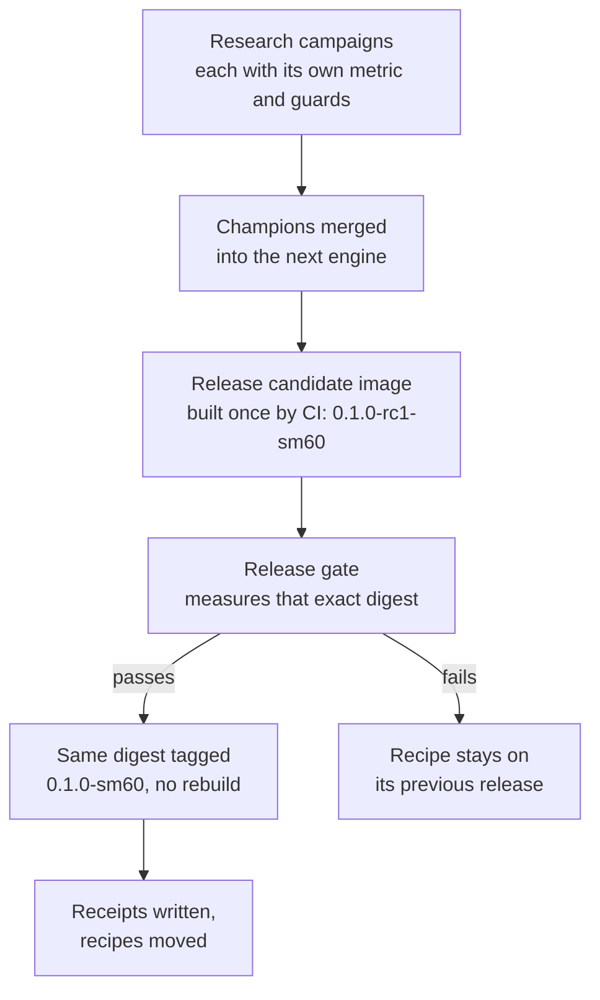

Every speed tensorless publishes comes with a receipt: what was measured, on what, by whom. This page explains how an engine release is made, why the image you pull is byte for byte the one that was measured, and how to read a receipt's scope.

## One lineage, many images

There is one engine, and it moves forward in releases: engine-v0.1.0, then the next. Each release is built once for each GPU architecture it supports, and each build is one container image:

```text
ghcr.io/iammrduncan/tensorless-engine:0.1.0-sm60
                                      └─┬─┘ └┬─┘
                              engine release  GPU architecture
```

Recipes never point at that tag. They point at the image's **digest**, the sha256 of its manifest, which no one can move. A tag is a name for people; the digest is what runs.

Older images stay in the registry. A model whose recipe has not moved to a new release keeps running on the release it was measured with. So a new release never silently changes a model you already use: its recipe has to move, and a recipe moves only with a new receipt.

## From champion to release



This is the process for later releases. engine-v0.1.0 is a single climb's champion, exported as is, and its published image went through steps 3 to 6.

1. **Campaigns find improvements.** Each hill-climb campaign starts from the latest engine release and keeps its best change, its **champion** ([Where the engine comes from](the-engine.md)).
2. **Champions are merged** into the next engine, with a check that each one's changes are really there. A champion only had to beat its own campaign's previous best, so a change that was lost along the way is re-applied and measured again.
3. **CI builds a release candidate once.** A GitHub workflow builds the engine image from the repository's Containerfile and publishes it as, for example, `0.1.0-rc1-sm60`. Its digest is printed for the gate.
4. **The release gate measures that digest** on a real card, for every recipe that will move to it.
5. **The measured digest becomes the release.** A second workflow copies the image to its release tag, `0.1.0-sm60`, without rebuilding it, then checks that the tag points at exactly the measured digest. If the digests differ, it fails.
6. **The receipts are written and the recipes move,** in the same change.

Step 5 is the important one. A rebuild, even from the same source, can produce a different binary. Promoting the measured digest instead means the release is not "built the same way as what was measured": it *is* what was measured.

For engine-v0.1.0, `0.1.0-rc1-sm60` and `0.1.0-sm60` are the same image, `sha256:35409ff97c2f518e468790c28bd19206ae777a945fcffe5775585e28fd9939a7`.

## What the gate checks

The design asks the release gate for these, on each card, for each recipe:

- the build's own checks (the P100 image runs the PN format's golden tests while it builds);
- each model's numerics against the previous release, within that model's recorded bars;
- speed no worse than any merged champion, within measured noise;
- decode at long contexts (32K and 65K on the P100) and prefill;
- the model's quality checks, once per release.

engine-v0.1.0 was the first release, so there was no previous release to compare against. Its numerics and quality were held by the hill climb that produced it. The published image was then measured on a P100 for both recipes. Long-context decode on this engine has not been measured yet, and the receipts say so. [Known limits](../project/known-limits.md) keeps the list.

If a change helps one model and fails another's check, the design's answer is not to fork the engine. The failing model's recipe stays on the previous release, and the release notes record why.

## What "measured" means

Two kinds of measurement appear in the receipts, and both time decode the same way: from outside the engine, by stamping each streamed token as it arrives.

- **The research judge** built the engine from source with the image's CUDA configuration and timed it on one P100: 256 greedy tokens after a cold prompt of about 600 tokens, the median of confirmation blocks. This is where a recipe's `decode_tps` comes from.
- **`tensorless bench`** measures the published image the same way: a warm-up, then greedy runs with a fixed seed and no prompt cache, decode speed as tokens over the time between the first and last streamed token. Its prompt is different (the start of the Apache-2.0 license text), so expect a few percent of difference from the research number.

For engine-v0.1.0, the published image measured within half a percent of the research numbers: 30.03 against 30.06 tok/s for Qwen3.8-27B-PN3, and 26.18 against 26.26 for Qwen3.8-27B-UD-IQ3_XXS-Q3Floor.

Timing between streamed tokens, rather than trusting the server's own timer, means the number is what a client sees. It also means a slow network adds to the time to the first token but not to the decode rate. You can run `tensorless bench` on your own card and compare: [Benchmark a running server](../how-to/use/benchmark.md).

## How to read a receipt

A number on its own says little. A receipt gives every number its **scope**:

- **which build:** a source build of a research commit, or the published image by digest;
- **which model file:** by sha256;
- **which card:** a Tesla P100-PCIE-16GB, its reported compute capability and memory;
- **what work:** how many tokens, after how long a prompt, code or prose, greedy or not, how many runs;
- **what was not measured.**

Read the last item as carefully as the others. "30 tok/s" is true at short context. It is not a claim about 65K context, about batched requests, or about a run with your own flags. The [receipts reference](../reference/receipts.md) has engine-v0.1.0's in full.
