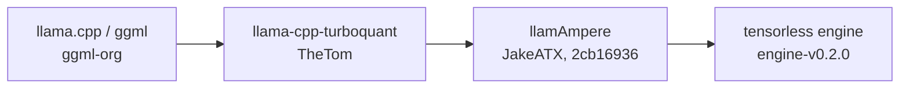

The tensorless engine is a fork of llama.cpp, several forks deep, with kernels written for the Tesla P100. This page explains where it came from, what it adds, and how its PN kernels were tuned by two automated hill climbs: one took a model's decode from 7.74 to about 30 tokens per second, and the next took its prefill from 121 to 200.

## The lineage

- **[llama.cpp](https://github.com/ggml-org/llama.cpp)** is the foundation: the GGUF format, the quantization types, `llama-server` and the CUDA backend.
- **[llama-cpp-turboquant](https://github.com/TheTom/llama-cpp-turboquant)** added TurboQuant KV-cache types and native multi-token prediction.
- **[llamAmpere](https://github.com/JakeATX/llamAmpere)** added an EXL3 path and Qwen3.8 work. The tensorless engine starts from its commit `2cb16936`.

All three are MIT-licensed, and their notices travel with the engine. tensorless's own changes are Apache-2.0. The [credits](../project/credits.md) name everyone else whose work shaped it.

## What the fork adds

Compared with its upstream base, the engine at engine-v0.2.0 changes 64 files. The main additions, listed in [`engine/PROVENANCE.md`](https://github.com/iammrduncan/tensorless/blob/main/engine/PROVENANCE.md):

- **P100 decode kernels.** Split-KV flash-decoding attention over a q4_0 KV cache, quantized GEMVs for `sm_60` (including an IQ3_XXS kernel that decodes through an fp16 table), Q3_K, Q4_K and Q6_K kernels, an output-head kernel, prefill dequantization and chunked GEMM, and fused norms.
- **The PN weight types,** `pn3t` and `pn4t`, with a CPU reference decoder, CUDA dequantization and `sm_60` GEMV kernels. See [Why a P100-native weight format](pn-format.md).
- **The PN prefill path,** new in engine-v0.2.0: GEMM kernels for a prompt's batched products of PN weights, in place of dequantize-to-fp32 plus cuBLAS SGEMM. See [The prefill climb](#the-prefill-climb).
- **Tools for checking it:** a teacher-forced logits tool and golden tests for the PN format.

The P100 kernels for standard weight types are opt-in. An environment variable such as `GGML_CUDA_FATTN_SM60=1` switches one on, and the recipe sets exactly the switches that were measured. The PN kernels, the prefill path included, run whenever a tensor is `pn3t` or `pn4t`, and a few exact changes, such as the IQ2 shared-memory codebook, are on by default on sm_60. The [engine switches reference](../reference/engine-switches.md) lists them.

## Tuned by automated hill climbs

Most of the engine's speed on Qwen3.8-27B-PN3 came from two **hill climbs**: long runs in which AI agents proposed changes to the engine, and a judge measured each one and kept it only if it was faster and still correct. The first climb made decode faster and produced engine-v0.1.0. The second started from that release, made prefill faster, and produced engine-v0.2.0.

Both climbs ran on [Thermite](https://usethermite.com), an open-source autoresearch harness ([source](https://github.com/iammrduncan/thermite)). Thermite's central idea is that the agents do not decide what counts as better:

- **Agents propose.** Each attempt is a change to the engine's code, proposed by an AI model.
- **A judge measures.** The judge builds the change, runs it on a real P100 and times it from outside the engine. The agents cannot see the judge's held-out checks or change how it measures.
- **Guards hold the numerics.** An attempt that is faster but changes the model's output beyond its bars is rejected, however fast it is.
- **Only confirmed wins are kept.** A faster attempt is measured again before it becomes the new best, the **champion**. Each new champion only has to beat the one before it.

### The decode climb

The numbers for the climb that produced engine-v0.1.0:

| | |
|---|---:|
| Judged attempts | 131 |
| Confirmed improvements | 28 |
| Qwen3.8-27B-PN3 decode at the start (code / prose prompt) | 7.74 / 7.73 tok/s |
| Qwen3.8-27B-PN3 decode at the end (code / prose prompt) | 30.06 / 30.18 tok/s |
| Speed-up | 3.89× |

Short context means 256 greedy tokens after a cold prompt of about 600 tokens, on one P100.

### The prefill climb

In engine-v0.1.0, every batched product of PN weights in a prompt dequantized the weight to fp32 and ran cuBLAS SGEMM. The second climb replaced that path. The numbers for the climb that produced engine-v0.2.0:

| | |
|---|---:|
| Attempts | 369 |
| Promoted improvements | 26 |
| Qwen3.8-27B-PN3 prefill at the start (code / prose prompt) | 121.4 / 119.6 tok/s |
| Qwen3.8-27B-PN3 prefill at the end (code / prose prompt) | 200.1 / 198.9 tok/s |
| Speed-up | 1.65× |
| Qwen3.8-27B-PN3 decode at the start and at the end (code prompt) | 29.95 and 30.43 tok/s |

Prefill is one cold prompt of about 4,100 tokens, timed from the request to the first token, on one P100. The decode was a guard in this climb: no step could leave it more than 1% below the starting point.

The first ten promotions left the arithmetic of a full 512-token batch as it was: faster dequantization, GEMM kernels that add each output's products in cuBLAS's order, and dequantizing the next weight while the current product runs. They reached 152 tok/s. The rest came from doing the deeper blocks' products on fp16 operands with fp32 sums (the P100 runs fp16 arithmetic at twice its fp32 rate), and from running two 512-token batches of a prompt as one. Those steps change the arithmetic, so the numerics bars below decided how far they could go. The plain fp16 products start at block 31, because the bars failed at block 30. Blocks 27 to 30 take a more careful version, with shorter fp16 sums, away from the start and the end of a prompt.

### What the guards held

Speed alone is easy to fake: skip work, lose precision, return the wrong token faster. So every step of both climbs was held to these bars, against that climb's starting point:

- **Qwen3.8-27B-PN3's outputs:** KL divergence within 2.593e-3 over 128 forced prose tokens, the same top token at 95% or more of positions, and decode-path perplexity within 0.25%.
- **Qwen3.8-27B-UD-IQ3_XXS-Q3Floor's text:** bit-identical greedy output, every step. This model shares most of the engine's code paths, so a change that broke it was caught even when it was aimed at PN.
- **The PN format itself:** the golden test blocks, and one real tensor of each PN class, decoded bit-exactly on CPU and GPU.

The [receipts](../reference/receipts.md) have the full measurements.

### What a climb does not guarantee

A hill climb finds changes that help the case it measures. The decode climb measured decode at short context, and the prefill climb measured a prompt of about 4,100 tokens. Neither re-measured 32K and 65K contexts, where attention costs more of each token, so those numbers are still open ([Known limits](../project/known-limits.md)). Each climb also held the numerics against its own starting point, so the model's quality checks are the release gate's to repeat, and that is still outstanding too. And a judge only sees the requests it sends: the prefill climb's judge never sent a follow-up request on a cached prompt, and its champion aborted on one. A run of the engine before the release found it, and engine-v0.2.0 has the fix ([Receipts](../reference/receipts.md#a-fault-found-before-the-release)). See [How a release is made](releases-and-receipts.md).

## Earlier work

The PN kernels came from the Thermite climbs. Before that, earlier P100 kernel campaigns, run with [pi-autoresearch](https://github.com/davebcn87/pi-autoresearch), built kernels for the standard llama.cpp types, and Qwen3.8-27B-UD-IQ3_XXS-Q3Floor was the model they were first tuned on. That is why the Q3Floor model is also a launch target, and why it served as the comparison for every PN measurement.

## How the source gets here

The engine was developed in a separate research repository. At each release, its `engine/` folder is exported into tensorless at the exact commit that was measured. The export:

- leaves out research-only files (the harness's state and notes);
- rewrites a handful of comment lines that pointed into the research repository, one line for one line, so line numbers and compiled code do not change;
- refuses to finish if it finds a private name or path anywhere it should not be;
- writes `engine/PROVENANCE.md`: the upstream base, the research commit, a digest of the whole tree, and what was changed.

So the source in `engine/` is the code that was measured, and `PROVENANCE.md` says how to check that.
